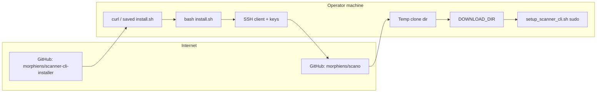

# Security Guide — Scanner CLI Installer

This document describes the security model, threats, current controls, known gaps, and recommended practices for the **scanner-cli-installer** repository (`install.sh`). It is intended for operators who run the installer on production or lab machines, maintainers who change the script, and security reviewers who assess Morphle’s scanner deployment supply chain.

**Scope:** This repository contains only `install.sh`, which bootstraps the Scanner CLI by cloning a subset of files from the private `morphiens/scano` repository and invoking `setup_scanner_cli.sh`. Downstream behavior (Python dependencies, systemd units, USB tooling, etc.) lives in the cloned payload and is referenced only at a high level here.

**Last reviewed:** 2026-11-12 (against `install.sh` in this repo).

---

## Table of contents

1. [Summary](#summary)
2. [Architecture and trust boundaries](#architecture-and-trust-boundaries)
3. [Threat model](#threat-model)
4. [Current security controls](#current-security-controls)
5. [Known risks and gaps](#known-risks-and-gaps)
6. [Secure installation (operators)](#secure-installation-operators)
7. [Hardening recommendations (maintainers)](#hardening-recommendations-maintainers)
8. [SSH and GitHub access](#ssh-and-github-access)
9. [Privileged execution and filesystem placement](#privileged-execution-and-filesystem-placement)
10. [Downstream payload (`scano`)](#downstream-payload-scano)
11. [Compliance mapping](#compliance-mapping)
12. [Incident response and reporting](#incident-response-and-reporting)
13. [References](#references)

---

## Summary

| Area | Posture |
|------|---------|
| **Distribution** | Public `install.sh` via GitHub raw content; one-liner uses `curl \| bash` |
| **Payload source** | Private Git clone over SSH (`morphiens/scano`), shallow clone of a **branch** ref |
| **Integrity verification** | None today for installer script or cloned files (no checksums, signatures, or commit pinning) |
| **Authentication** | SSH keys to GitHub (user account or generated installer key) |
| **Privilege** | May run `setup_scanner_cli.sh` under `sudo` |
| **Shell hardening** | `set -euo pipefail`, `mktemp -d`, `EXIT` trap for clone dir |

The installer is optimized for **operational convenience** on trusted Morphle networks and machines. For **high-assurance** environments (shared CI, unattended installs, internet-facing hosts), follow the [Secure installation](#secure-installation-operators) and [Hardening](#hardening-recommendations-maintainers) sections before relying on the default one-liner.

---

## Architecture and trust boundaries

### Data flow



### Trust assumptions

You implicitly trust:

1. **Morphle / Morphiens** — authors of `install.sh`, `scano` branch content, and release process.
2. **GitHub** — transport (HTTPS for installer, SSH for clone), account security, and repository access controls.
3. **Operator environment** — integrity of `~/.ssh`, sudo configuration, and paths such as `/etc/morphle/code`.
4. **Downstream setup script** — whatever `setup_scanner_cli.sh` installs (Python packages, binaries, services).

### Untrusted inputs

The script treats these as sensitive but **does not fully validate** them today:

- `SUDO_USER`, `USER`, `HOME` (used to resolve `ACTUAL_HOME` via `eval`)
- Branch name `SOURCE_REPO_BRANCH` (maintainer-controlled constant, but **mutable** on the server)
- Interactive `read` responses (SSH setup)

---

## Threat model

### Primary threats

| ID | Threat | Example scenario | Typical impact |
|----|--------|------------------|----------------|
| T1 | **Installer tampering** | Compromised GitHub account or raw-content CDN swap | Arbitrary code on first run |
| T2 | **`curl \| bash` hazards** | Truncated download, HTML error page executed as shell | Broken or malicious partial script |
| T3 | **Mutable Git ref** | Branch `feat/cli-setup-v5.2` updated with malicious commit | Different payload per install |
| T4 | **SSH MITM** | `StrictHostKeyChecking=no` during GitHub probe | Credential / clone redirection |
| T5 | **Leaked SSH keys** | Empty-passphrase installer-generated key, shared machine | Unauthorized repo access |
| T6 | **Excessive privilege** | `sudo setup_scanner_cli.sh` on compromised payload | System-wide change |
| T7 | **Python supply chain** | Unpinned `requirements.txt` in payload | Malicious or vulnerable dependencies |
| T8 | **Insider / deploy key sprawl** | Long-lived keys without rotation | Persistent backdoor to `scano` |

### Out of scope for this repo

- Runtime security of the Scanner CLI after install
- Network security of scanner devices
- GitHub organization IAM policies (documented as dependencies)

---

## Current security controls

The following are **already implemented** in `install.sh` and align with common shell and installer guidance.

### Shell robustness

- **`set -euo pipefail`** — fail fast on errors, unset variables, and pipeline failures ([transang.me](https://transang.me/best-practice-to-make-a-shell-script/), [learn-bash.net security review](https://learn-bash.net/review/security/)).
- **Prerequisite check** — exits if `git` is missing.
- **Storage checks** — verifies parent directory exists and is writable before clone.
- **Explicit file allowlist** — copies only named files from `scanner_master_cli` (reduces “copy entire tree” surprise).
- **Temporary clone** — `TEMP_CLONE_DIR=$(mktemp -d)` with `trap 'rm -rf $TEMP_CLONE_DIR' EXIT` ([mktemp safety](https://www.golinuxcloud.com/bash-mktemp/)).
- **Non-interactive clone guard** — `GIT_TERMINAL_PROMPT=0`, `GIT_SSH_COMMAND` with `BatchMode=yes` for unattended behavior.
- **SSH key permissions** — attempts `chmod 700` on `.ssh`, `600` on private keys, `644` on `.pub` when generating keys.
- **Root warning** — warns when executed as true root without `SUDO_USER`.

### Access control (operational)

- **SSH-only clone** — avoids embedding HTTPS tokens in the installer; access is tied to GitHub SSH credentials.
- **Fail closed without TTY** — if SSH auth is missing and stdin is not a terminal, the script exits rather than prompting.

### Configuration snapshot (maintainers)

Current constants in `install.sh`:

- `SOURCE_REPO="git@github.com:morphiens/scano.git"`
- `SOURCE_REPO_BRANCH="feat/cli-setup-v5.2"`
- `SOURCE_SUBDIR="scripts/scanner_master_cli"`
- Payload files: `setup_scanner_cli.sh`, `interactive_maneuver.py`, `log_collector.py`, `drive_uploader.py`, `requirements.txt`

---

## Known risks and gaps

| Priority | Issue | Location / behavior | Guidance |
|----------|--------|---------------------|----------|
| **P0** | **No integrity attestation** for `install.sh` or cloned files | Entire flow | Add signed releases or published SHA-256 (+ optional Cosign) per [Anchore](https://oss.anchore.com/docs/installation/verification/), [inference-gateway](https://github.com/inference-gateway/cli/blob/main/docs/binary-verification.md) |
| **P0** | **Branch pinning** instead of immutable commit | `SOURCE_REPO_BRANCH` | Pin `SOURCE_REPO_COMMIT` (full SHA); verify with `git rev-parse` after clone ([poutine](https://boostsecurityio.github.io/poutine/rules/unverified_script_exec/), [Kusari pinning](https://www.kusari.dev/blog/pinning-dependencies/)) |
| **P1** | **`curl \| bash` documented as primary path** | Header comment | Document download-verify-run; use `curl --proto '=https' --tlsv1.2 -fsSL` ([dontcurl.sh](https://dontcurl.sh/), [KodeKloud](https://kodekloud.com/blog/is-it-safe-to-pipe-curl-into-bash/)) |
| **P1** | **`StrictHostKeyChecking=no`** for GitHub SSH test | `check_ssh_auth_silent` | Pre-seed `known_hosts` with [GitHub published keys](https://docs.github.com/en/authentication/keeping-your-account-and-data-secure/githubs-ssh-key-fingerprints); use `StrictHostKeyChecking yes` ([Security Alliance SSH guide](https://frameworks.securityalliance.org/guides/endpoint-security/ssh-client-and-key-management-hardening/)) |
| **P1** | **SSH keys generated with empty passphrase** | `ssh-keygen ... -N ""` | Prefer passphrase + `ssh-agent`, or **read-only deploy keys** per device ([GitHub deploy keys](https://docs.github.com/en/authentication/connecting-to-github-with-ssh/managing-deploy-keys)) |
| **P2** | **`eval echo "~$ACTUAL_USER"`** | `ACTUAL_HOME` | Use `getent passwd "$ACTUAL_USER"` or `readlink -f` patterns; avoid `eval` ([OWASP command injection](https://cheatsheetseries.owasp.org/cheatsheets/OS_Command_Injection_Defense_Cheat_Sheet.html), [shellharden](https://github.com/anordal/shellharden/blob/master/how_to_do_things_safely_in_bash.md)) |
| **P2** | **`chmod +x` on all payload files** including `requirements.txt` | Copy loop | Only mark true executables executable |
| **P2** | **Shallow clone (`--depth 1`)** | `git clone` | Good for speed; prevents independent audit of history—compensate with signed tags/commits |
| **P3** | **No automated ShellCheck in CI** | Repository | Add workflow per [Cloudanix example](https://github.com/Cloudanix/install-scripts/blob/main/.github/workflows/shellcheck.yml) |
| **P3** | **`local` used outside function** (lines ~206–207) | SSH retry block | Bash error on some paths; fix for reliability |

---

## Secure installation (operators)

### Recommended flow (production or shared machines)

Do **not** pipe directly to `bash` on machines that hold secrets or production data ([Security Stack Exchange](https://security.stackexchange.com/questions/213401/is-curl-something-sudo-bash-a-reasonably-safe-installation-method), [poutine RGS pattern](https://boostsecurityio.github.io/poutine/rules/unverified_script_exec/)).

```bash
# 1) Fetch over HTTPS only (no downgrade on redirect)
curl --proto '=https' --tlsv1.2 -fsSL \
  -o install.sh \
  "https://raw.githubusercontent.com/morphiens/scanner-cli-installer/main/install.sh"

# 2) Review (mandatory for production)
less install.sh

# 3) Verify integrity when Morphle publishes a hash or signed release
# echo "<published-sha256>  install.sh" | sha256sum -c -

# 4) Run as normal user; let script request sudo if needed
bash install.sh
```

### Pinning the installer script

Prefer an **immutable Git ref** for the installer itself (commit SHA, not branch name):

```bash
COMMIT="<full-40-char-sha>"  # from git ls-remote or release notes
curl --proto '=https' --tlsv1.2 -fsSL -o install.sh \
  "https://raw.githubusercontent.com/morphiens/scanner-cli-installer/${COMMIT}/install.sh"
```

### SSH hardening before install

```bash
mkdir -p ~/.ssh && chmod 700 ~/.ssh
# Add GitHub host keys from official documentation:
# https://docs.github.com/en/authentication/keeping-your-account-and-data-secure/githubs-ssh-key-fingerprints
ssh -T [email protected]  # expect success or "successfully authenticated" message
```

Use a **dedicated SSH key** (deploy key or machine user) with **read-only** access to `scano` only ([GitHub: managing deploy keys](https://docs.github.com/en/authentication/connecting-to-github-with-ssh/managing-deploy-keys)).

### When to avoid this installer

- **CI runners with secrets** — use pinned commits + checksum verification ([GitHub gh-aw RGS-018 pattern](https://github.com/github/gh-aw/pull/43716)).
- **Hosts without SSH access to `scano`** — installer cannot succeed; use an alternative distribution (signed tarball, internal package mirror).
- **Regulated environments requiring SBOM/signatures** — require maintainer deliverables per [NIST SSDF](https://csrc.nist.gov/pubs/sp/800/218/final) before approval.

---

## Hardening recommendations (maintainers)

Prioritized engineering backlog aligned with industry practice:

### 1. Immutable, verifiable releases (P0)

- Tag releases of `scanner-cli-installer` and `scano` CLI payloads together.
- Publish `checksums.txt` + Cosign Sigstore bundle from GitHub Actions OIDC ([GoReleaser signing guide](https://goreleaser.com/customization/sign/sign/), [SLSA verification](https://slsa.dev/spec/v1.2/verifying-artifacts)).
- Replace `SOURCE_REPO_BRANCH` with **`SOURCE_REPO_COMMIT`** validated after clone:

  ```bash
  expected="<sha>"
  actual=$(git -C "$TEMP_CLONE_DIR" rev-parse HEAD)
  [ "$actual" = "$expected" ] || { echo "Commit mismatch"; exit 1; }
  ```

### 2. Installer distribution (P0–P1)

- Add `SECURITY.md`-published SHA-256 for each release `install.sh`.
- Change docs to **download → verify → execute**; keep one-liner only for dev VMs.
- Pin raw GitHub URLs in docs to **commit SHAs**, not `main`.

### 3. SSH and secrets (P1)

- Remove `StrictHostKeyChecking=no`; document `known_hosts` bootstrap in install preflight.
- Stop auto-generating passphrase-less keys unless paired with deploy-key workflow and key rotation SOP (≤ 180 days) ([Cortex APPSEC_CICD_6](https://cortex-docs.paloaltonetworks.com/appsec-rules/ci-cd-security/identity-access-management/appsec-cicd-6)).
- Recommend GitHub App or fine-grained PAT alternatives for automation where SSH is unnecessary.

### 4. Code quality gates (P2–P3)

- CI: **ShellCheck** (`-S warning`) on every PR.
- Optional: reject `curl | bash` in internal CI templates ([shellscan SHELLSCAN-CURL-PIPE](https://github.com/coroboros/shellscan/blob/main/README.md)).
- Fix `eval` for home directory resolution; quote `trap` paths: `trap 'rm -rf -- "$TEMP_CLONE_DIR"' EXIT`.

### 5. Supply chain metadata (P2)

- Generate CycloneDX/SPDX SBOM for Python payload in `scano` build ([OWASP SSCS](https://cheatsheetseries.owasp.org/cheatsheets/Software_Supply_Chain_Security_Cheat_Sheet.html)).
- Use `pip install --require-hashes` with compiled `requirements.txt` in deployment ([pip secure installs](https://pip.pypa.io/en/latest/topics/secure-installs/)).

### 6. Separation of duties in release CI (P2)

- Split build, sign, and publish jobs; minimize `contents: write` on build ([GoReleaser supply chain article](https://zenn.dev/shunsuke_suzuki/articles/goreleaser-separate-build-release)).

---

## SSH and GitHub access

### Models

| Model | Use case | Security notes |
|-------|----------|----------------|
| **Personal SSH key** | Engineer laptop | MFA on GitHub; passphrase on key; review [deploy keys on repos](https://docs.github.com/en/authentication/keeping-your-account-and-data-secure/reviewing-your-deploy-keys) |
| **Deploy key (read-only)** | Scanner workstation | One key per repo; no passphrase on server—protect server disk ([GitHub deploy keys](https://docs.github.com/en/authentication/connecting-to-github-with-ssh/managing-deploy-keys)) |
| **GitHub App** | Fleet installs | Prefer for rotation and scoped permissions |

### Rotation

1. Generate new key → add to GitHub → verify clone → remove old key ([Cortex rotation guidance](https://cortex-docs.paloaltonetworks.com/appsec-rules/ci-cd-security/identity-access-management/appsec-cicd-6)).
2. Audit quarterly: unknown deploy keys, write-enabled deploy keys ([APPSEC_CICD_26](https://cortex-docs.paloaltonetworks.com/appsec-rules/ci-cd-security/pipeline-based-access-controls/appsec-cicd-26)).

---

## Privileged execution and filesystem placement

### Download directory

The installer prefers `/etc/morphle/code/scanner_master_cli` when `/etc/morphle/code` exists and is writable; otherwise `~/Downloads/scanner_master_cli`.

- Ensure **only intended operators** can write `/etc/morphle/code`; world-writable paths allow payload substitution before `setup_scanner_cli.sh` runs.
- System-wide binaries should remain **root-owned** and not group/world-writable ([CIRSEC CB-DEB-FS-011](https://baselines.cirsec.org/b/debian/CB-DEB-FS-011), [CIS-style binary dir ownership](https://ato-pathways.com/catalogs/xccdf/benchmarks/ssg-uos20-ds.xml:latest/items/xccdf_org.ssgproject.content_rule_dir_ownership_binary_dirs)).

### sudo

The installer invokes `sudo bash "$INSTALL_DIR/setup_scanner_cli.sh"` when not root. Treat the payload as **fully trusted** before granting sudo—review `setup_scanner_cli.sh` on every bump of `scano` commit.

---

## Downstream payload (`scano`)

This installer copies a fixed list of files and delegates to `setup_scanner_cli.sh`. Operators and reviewers should also:

1. **Pin Python dependencies** with hashes (`pip-compile --generate-hashes`) and `--require-hashes` in production ([CircleCI supply chain guide](https://circleci.com/docs/guides/security/security-supply-chain/), [PyPI integrity](https://docs.pypi.org/using-pypi/package-security/package-integrity/)).
2. **Scan for vulnerabilities** (OSV, `pip-audit`, etc.) on each release ([NIST SSDF PW.7.x](https://csrc.nist.gov/pubs/sp/800/218/final)).
3. **Treat `drive_uploader.py` and USB-related scripts** as handling sensitive data paths—review OAuth tokens, paths, and logging in `scano` (out of repo scope but part of end-to-end risk).

---

## Compliance mapping

High-level alignment (not a certification statement):

| Framework / standard | Relevant themes for this installer |
|----------------------|-----------------------------------|
| [OWASP SCVS v4 Package Management](https://scvs.owasp.org/scvs/v4-package-management/) | TLS, integrity on retrieve, immutable refs |
| [OWASP Software Supply Chain Security Cheat Sheet](https://cheatsheetseries.owasp.org/cheatsheets/Software_Supply_Chain_Security_Cheat_Sheet.html) | MFA, logging, SBOM, dependency monitoring |
| [OWASP DevSecOps — Artifact signing](https://owasp.github.io/DevSecOpsGuideline/2-Process/2-3-Build/2-3-6-Supply-Chain-Security/2-3-6-2-Artifact-Signing-and-Provenance/) | Verify before promote/deploy |
| [SLSA Build levels](https://slsa.dev/spec/v1.2/build-requirements) | Provenance for release artifacts |
| [NIST SP 800-218 SSDF v1.1](https://csrc.nist.gov/pubs/sp/800/218/final) | PS.3, PW.4, PW.7, RV.1 — provenance, deps, vuln response |
| [EO 14028 software acquisition FAQs](https://www.nist.gov/itl/executive-order-14028-improving-nations-cybersecurity/software-supply-chain-security-guidance-12) | Attestation and artifact transparency |

---

## Incident response and reporting

If you suspect a compromised install, branch, or GitHub key:

1. **Stop** — do not re-run `install.sh` or `setup_scanner_cli.sh` on affected hosts.
2. **Preserve evidence** — save `install.sh`, cloned files, `~/.ssh` authorized_keys listing, and shell history; note `git rev-parse HEAD` from last successful clone.
3. **Revoke** — remove deploy keys / PATs; rotate SSH keys implicated ([GitHub deploy key review](https://docs.github.com/en/authentication/keeping-your-account-and-data-secure/reviewing-your-deploy-keys)).
4. **Report** — contact Morphle security / engineering with timestamp, machine hostname, user, and commit SHAs.
5. **Recover** — reinstall from a **known-good signed or checksum-verified** release only after root cause is identified.

Enable centralized logging on scanner hosts where possible (SSCS detective controls per [OWASP SSCS](https://cheatsheetseries.owasp.org/cheatsheets/Software_Supply_Chain_Security_Cheat_Sheet.html)).

---

## References

The following external sources informed this document (≥ 25 distinct publications):

1. Anchore — Verifying Downloads: https://oss.anchore.com/docs/installation/verification/
2. Anchore Syft issue — checksums without signature: https://github.com/anchore/syft/issues/2884
3. inference-gateway CLI — binary verification: https://github.com/inference-gateway/cli/blob/main/docs/binary-verification.md
4. AWS SAM CLI — installer verification: https://docs.aws.amazon.com/serverless-application-model/latest/developerguide/reference-sam-cli-install-verify.html
5. Palivane — verifying remote install manifests: https://palivane.io/docs/verifying-downloads
6. OWASP SCVS v4 — Package Management: https://scvs.owasp.org/scvs/v4-package-management/
7. OWASP — NPM Security Cheat Sheet (supply chain section): https://github.com/OWASP/CheatSheetSeries/blob/master/cheatsheets/NPM_Security_Cheat_Sheet.md
8. OWASP DevSecOps — Artifact Signing and Provenance: https://owasp.github.io/DevSecOpsGuideline/2-Process/2-3-Build/2-3-6-Supply-Chain-Security/2-3-6-2-Artifact-Signing-and-Provenance/
9. OWASP DevSecOps — Deploy: https://owasp.github.io/DevSecOpsGuideline/2-Process/2-6-Deploy/2-6-1-Deploy/
10. OWASP — Software Supply Chain Security Cheat Sheet: https://cheatsheetseries.owasp.org/cheatsheets/Software_Supply_Chain_Security_Cheat_Sheet.html
11. Steinbaugh — Shell strict mode: https://steinbaugh.com/posts/shell-strict-mode.html
12. Tran Sang — `set -Eeuo pipefail`: https://transang.me/best-practice-to-make-a-shell-script/
13. KodeKloud — curl into bash safety: https://kodekloud.com/blog/is-it-safe-to-pipe-curl-into-bash/
14. dontcurl.sh — fetch, read, verify, run: https://dontcurl.sh/
15. Boost Security — unverified script execution (poutine): https://boostsecurityio.github.io/poutine/rules/unverified_script_exec/
16. Better CLI — self-executing installers: https://bettercli.org/design/distribution/self-executing-installer/
17. Security Stack Exchange — curl sudo bash: https://security.stackexchange.com/questions/213401/is-curl-something-sudo-bash-a-reasonably-safe-installation-method
18. SLSA v1.2 — Build requirements: https://slsa.dev/spec/v1.2/build-requirements
19. SLSA v1.2 — Verifying artifacts: https://slsa.dev/spec/v1.2/verifying-artifacts
20. slsa-framework/slsa-verifier: https://github.com/slsa-framework/slsa-verifier
21. GoReleaser — signing with Cosign: https://goreleaser.com/customization/sign/sign/
22. GoReleaser — Cosign v3 bundles: https://goreleaser.com/blog/cosign-v3/
23. Zenn — separate build/release for supply chain: https://zenn.dev/shunsuke_suzuki/articles/goreleaser-separate-build-release
24. CIRSEC CB-DEB-FS-011 — system binaries ownership: https://baselines.cirsec.org/b/debian/CB-DEB-FS-011
25. Security Alliance — SSH client hardening: https://frameworks.securityalliance.org/guides/endpoint-security/ssh-client-and-key-management-hardening/
26. GitHub — SSH key fingerprints: https://docs.github.com/en/authentication/keeping-your-account-and-data-secure/githubs-ssh-key-fingerprints
27. how2.sh — pin SSH host keys in CI: https://how2.sh/posts/pin-ssh-host-keys-ci-secure-git-clones/
28. Mozilla infosec — OpenSSH guidelines: https://github.com/mozilla/infosec.mozilla.org/blob/master/docs/guidelines/openssh.md
29. GitHub — Managing deploy keys: https://docs.github.com/en/authentication/connecting-to-github-with-ssh/managing-deploy-keys
30. GitHub — Reviewing deploy keys: https://docs.github.com/en/rest/deploy-keys/deploy-keys
31. pip — Secure installs / hash mode: https://pip.pypa.io/en/latest/topics/secure-installs/
32. PyPI — Package integrity: https://docs.pypi.org/using-pypi/package-security/package-integrity/
33. CircleCI — Supply chain pinning: https://circleci.com/docs/guides/security/security-supply-chain/
34. NIST SP 800-218 (SSDF v1.1): https://csrc.nist.gov/pubs/sp/800/218/final
35. NIST — EO 14028 software supply chain FAQs: https://www.nist.gov/itl/executive-order-14028-improving-nations-cybersecurity/software-supply-chain-security-guidance-12
36. OWASP — OS Command Injection Defense: https://cheatsheetseries.owasp.org/cheatsheets/OS_Command_Injection_Defense_Cheat_Sheet.html
37. shellharden — safe bash patterns: https://github.com/anordal/shellharden/blob/master/how_to_do_things_safely_in_bash.md
38. Learn Bash — security review checklist: https://learn-bash.net/review/security/
39. GitHub Blog — repo-jacking and commit pinning: https://github.blog/security/supply-chain-security/how-to-stay-safe-from-repo-jacking/
40. Kusari — dependency pinning: https://www.kusari.dev/blog/pinning-dependencies/
41. GoLinuxCloud / mktemp manual — safe temp dirs: https://www.golinuxcloud.com/bash-mktemp/
42. GitHub — gh-aw PR (curl verify pattern): https://github.com/github/gh-aw/pull/43716

---

## Document maintenance

- Re-run this review when `install.sh` changes, when `SOURCE_REPO_BRANCH` or payload file list changes, or when distribution moves from raw `main` to tagged releases.
- Update the **Configuration snapshot** and **Known risks** tables to match the script.
